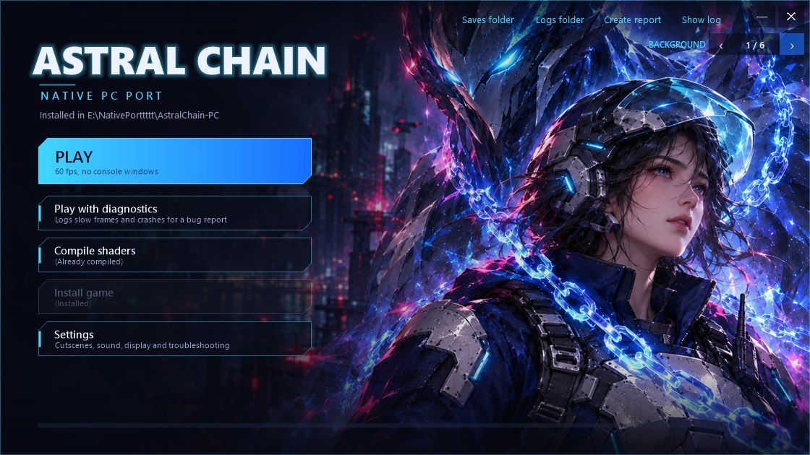

# Astral Chain PC

> [!IMPORTANT]
> **This project was built entirely with AI.** All of the code, tooling, reverse engineering and
> documentation in this repository was written by an AI model (Anthropic's Claude, through Claude Code, and Codex), directed,
> tested and reviewed by the project's owner. It is shared as is, as a fan project. If you prefer not to use
> AI-written code, you are free to skip it. As with any code from the internet, you build and run it at your own
> discretion.

An unofficial, experimental native Windows port of *Astral Chain* (Nintendo Switch, PlatinumGames, 2019), made by
**static recompilation**. The game's ARM64 code is translated to C and compiled into an ordinary Windows x64
program, and its NVN graphics calls run on Vulkan. There is no emulator or JIT.

You build it yourself from **your own** legally dumped game and keys. This repository contains no game code, assets,
shaders, keys or firmware, and never will. Everything the setup produces comes from your dump: do not share the
`build/`, `game/` or `userdata/` folders.

> **AI disclosure.** Most of the code, tooling, reverse engineering and documentation here was written by Claude
> (Anthropic) through Claude Code, directed and tested by the repository owner. It is shared as-is as a fan project.

## Status

| | |
| --- | --- |
| Tested | Title, menus, opening cutscene, character creation, the highway chase and File 01 up to its boss fight (played by the owner) |
| Frame rate | 60 fps target, cutscenes included (Dynamic-FPS patch, game speed correct at any frame rate). RTX 4090 / Ryzen 7 7800X3D: 57-60 fps. `AC_CUTSCENE_FPS=30` plays cutscenes exactly as the original does |
| Stability | Driver watchdog plus a GPU hang stop. No driver resets since 2026-10-19 across dozens of test runs |
| Saving | Works (tested in File 01) |
| Shader pauses | Shaders are compiled for your GPU before the game starts. Simulated first play of an area never recorded: 7 pauses over 50 ms, 0.49 s in total (26 and 8.0 s before 2026-10-21) |
| Not yet tested | The File 01 boss fight with the fix of its crash, and everything after it |

Known issues are listed under [Known issues](#known-issues).

## What's new

Fixes marked *not yet confirmed* were tested in scripted runs, but not yet confirmed in play.

**2026-10-21**

- **Launcher.** `Astral Chain Launcher.exe`: install, compile shaders, play without console windows, play with
  diagnostics and create a bug report, and settings for every option, over original key art (six backgrounds to
  pick from with the arrows at the top right). See [Playing](#playing).
- **Shaders compiled for your GPU before the game starts** ("Compiling for your GPU", about 10 s the first time).
  In-game, pipelines are linked from those compiled shaders instead of being compiled whole, and the recorded
  ones are built before their first draw. Most shader pauses in new areas are gone (see Status). *Not yet
  confirmed.*
- **ASTC textures are decoded on the GPU** instead of the CPU: no more 60-240 ms pauses when large textures load.
  Checked byte for byte against the CPU decoder.
- **Crash at the File 01 boss** (when it throws a container): the game stopped on a rumble value out of range. It
  now ignores such values. *Not yet confirmed.*
- **NSP base games** stopped setup at the RomFS step (issue #1). Setup now gives NSTool both the base game's and
  the update's title keys. *Not yet confirmed by the reporter.*
- A failed rebuild no longer loses the shader cache.
- Crash dumps in diagnostics mode; the watchdog script now records the game's exit code.

**2026-10-20**

- All of the game's shaders are translated before the first launch ("Preparing shaders").
- NVN's alpha test is emulated: defeated enemies no longer leave a dark tentacle mass. *Not yet confirmed.*
- Cutscene cuts keep their time at 60 fps, and sound skips gaps after a stall, so sound stays with the picture.
  *Not yet confirmed.* `AC_CUTSCENE_FPS=30` plays cutscenes at 30 fps as on the Switch.
- Dragging the window by its title bar no longer freezes the game; closing hides the window at once.
- Each save is also copied to a backup folder (the newest 30 are kept).
- Textures are uploaded ahead of first use on loading screens; the pipeline cache is kept between sessions.
- Fixed wrong textures on faces and armour, and a rare crash in the GPU write-back handler.

## Requirements

- Windows 10 or 11, 64-bit.
- A GPU with Vulkan 1.3. Developed on an NVIDIA RTX 4090; other GPUs are untested.
- [Python](https://www.python.org/downloads/windows/) 3.12 or newer, with the `py` launcher (the installer default).
- About **35 GB** free during setup. About 11 GB stays afterwards.
- An internet connection for the one-time setup. It downloads Zig, glslang and NSTool at pinned versions,
  checked by SHA-256.
- Your own dump:
  - the **base game** (title ID `01007300020FA000`), as an XCI or an NSP;
  - the **v1.0.1 update** NSP. Exactly v1.0.1 is required;
  - your console's **`prod.keys`**.

How to dump games and keys from your Switch is not covered here.

## Setup

1. Download this repository: **Code → Download ZIP**, or `git clone`. Put it in a folder you own, for example
   `C:\Games\AstralChain-PC`. The path should be short, and not on a network drive.
2. Start **`Astral Chain Launcher.exe`** in that folder and press **Install game**. Pick, when asked:
   1. your `prod.keys`;
   2. the base game (XCI or NSP);
   3. the v1.0.1 update NSP.
3. Wait. Setup extracts the game data, packs it into `game\romfs.bin`, then translates and compiles the game and
   its shaders. The first time takes roughly **15-40 minutes**, depending on your CPU and disk. Temporary files are
   removed at the end. The launcher shows the progress; **Cancel** stops it.

The game is installed in the launcher's folder. Once it is, **Install game** is greyed out.

If a step fails, fix the cause and press **Install game** again: finished steps are skipped.

Without the launcher, `setup.cmd` does the same in a console window. It also takes the files directly:
`setup.cmd --keys X:\prod.keys --base X:\AstralChain.xci --update X:\AstralChain-v1.0.1.nsp`.

Windows SmartScreen may warn about the launcher because it is not signed. Its source is `launcher\Launcher.cs`;
`python launcher\build.py` builds it again with the C# compiler that comes with Windows.

## Playing

Start **`Astral Chain Launcher.exe`**:

The arrows at the top right (**BACKGROUND ‹ 1 / 6 ›**) switch between six backgrounds; the choice is remembered.

| Button | What it does |
| --- | --- |
| **Play** | Starts the game, without console windows. After an update of this project it first rebuilds the game (about a minute) and its shaders |
| **Play with diagnostics** | The same, plus a log of where the time of each slow frame went and a crash dump if the game crashes. Afterwards it offers to create a report |
| **Compile shaders** | Prepares every shader for your GPU now. It says *(Already compiled)* when nothing changed, and *(Needs recompiling)* after an update of the game build, new recorded shader combinations, or a settings change that affects them. Play does this too when needed |
| **Settings** | Cutscene frame rate, pausing while minimized, save backups, sound resync, presentation mode, shader options and troubleshooting switches. Each one is explained in the window |
| **Create report** | Packs the last session's logs, the crash dump if there is one, and your Windows, CPU and GPU versions into `reports\`, for a bug report. No game files; your Windows user name is removed from the logs' paths |

`Play Astral Chain.cmd` and `Play Astral Chain (diagnostics).cmd` still work, with console windows.

| Switch | Keyboard |
| --- | --- |
| A / B / X / Y | J / K / I / U |
| L / R | Q / E |
| ZL / ZR | Z / C |
| + / - | Enter / Backspace |
| D-pad | Arrow keys |
| Left stick | W A S D |
| Right stick | T F G H |

XInput controllers (Xbox pads and compatibles) work too. The game pauses while its window is minimized, as on
the Switch's home menu (Settings: *Keep running while the game window is minimized*). In another window, the game
keeps running but takes no keyboard input.

- **Saves** are in `userdata\saves\` (the launcher's *Saves folder* link). Each save is also copied next to it
  (the newest 30 are kept); still, back that folder up from time to time.
- **Logs** of the last session are in `build\game\round-00\` (`trace.log`, `stderr.log`).
- **Shaders.** Before the game starts the first time, setup translates all of the game's shaders ("Preparing
  shaders", about 20 s on a 16-thread CPU), then compiles them for your GPU and driver ("Compiling for your GPU"),
  together with the render-state combinations recorded so far. Later launches skip both unless something changed
  (a game update, new recorded combinations, or a new graphics driver). A combination never seen before is linked
  from the compiled shaders when first drawn, without a long pause. The cache is in `build\game\cache\`.

### Safety

The game always runs under `astral_chain\run_guarded.ps1`, from the launcher too. It closes the game on the first
GPU driver error that Windows logs. The game also stops itself if the GPU stays busy for more than 1.2 s, before Windows would reset the driver.

### Updating

Download the new version over the old one, or `git pull`. The next **Play** rebuilds the game once, in about a
minute. Your saves, game data and shader cache are kept.

## Known issues

- Dark, shadow-like patches on scenery when fighting close to it were reported. Under investigation: a screenshot
  helps.
- Some short pauses remain when entering new areas: the game loading its own data, not shader compiling.
- Defeated enemies left a large dark tentacle mass for about two seconds. Cause found: the chimera blood effect
  dissolves through NVN's alpha test, which was not emulated. It now is (test runs of the highway chase show no
  mass), not yet confirmed in play.
- In-game cutscenes were reported with the sound behind the picture after camera cuts (the 60 fps mod's known limit:
  each cut ended up to a frame early). Cut ends now keep their time: the cutscene after the highway chase lasts
  35.192 s, as at the original 30 fps (35.193 s; 35.077 s before). Sound gaps after stalls are skipped to stay in
  sync. Not yet confirmed fixed.
- Rarely the game closes right at startup (`STOP host-shared-placeholder-reserve` in `trace.log`). Start it again.
- Save-slot thumbnails are not captured (`nvnTextureReadTexels` is not implemented).

Reports are welcome. The easiest way: play with **Play with diagnostics** in the launcher until the problem
happens, then attach the zip that **Create report** makes. Otherwise include `build\game\round-00\stderr.log` and
`trace.log` and your GPU and driver version, but no game files.

## Folder layout

| Path | What |
| --- | --- |
| `Astral Chain Launcher.exe` | The launcher (source in `launcher/`) |
| `setup.cmd`, `Play Astral Chain.cmd` | The same steps from a console window |
| `astral_chain/` | Translator driver, build system and Windows runtime (C) |
| `astral_chain/patches/` | Code patches of this project (pchtxt) |
| `third_party/` | Vendored sources: LASRecomp, Vulkan-Headers, VulkanMemoryAllocator, Dynamic-FPS patch |
| `docs/` | How it works, troubleshooting, development notes |
| `tools/` | *(created by setup)* Zig, glslang, NSTool |
| `game/` | *(created by setup)* your extracted update code, metadata and `romfs.bin` |
| `build/` | *(created by setup)* the compiled game and its shader cache |
| `userdata/` | *(created by setup)* saves, account profile, setup choices, launcher settings (`launcher.ini`) |
| `reports/` | *(created by the launcher)* reports made with **Create report** |

## Documentation

- [How it works](docs/how-it-works.md)
- [Troubleshooting](docs/troubleshooting.md)
- [Development notes](docs/development.md)

## Legal

This is an unofficial fan project, not affiliated with or endorsed by Nintendo or PlatinumGames. *Astral Chain* is
a trademark of Nintendo. No game code, assets, shaders, keys or firmware are distributed. Requests for them will be
closed.

The original code in this repository is under the MIT License (see `LICENSE`). Vendored third-party components keep
their own licenses, listed in [THIRD_PARTY_NOTICES.md](THIRD_PARTY_NOTICES.md).

## Credits

- [LASRecomp](https://github.com/peiikai/LASRecomp) (MIT): the ARM64 lifter, the NVN-on-Vulkan layer and the
  Maxwell shader translator this port builds on.
- [AstralChain-Dynamic-FPS](https://github.com/yogesh1239/AstralChain-Dynamic-FPS) by yogesh1239 (MIT): the
  60 fps patch.
- [astral-extractor](https://github.com/cabalex/astral-extractor) by cabalex: format research.
- The launcher's backgrounds and icon (`launcher/art/`, `launcher/icon.ico`) are original AI-generated images in the
  style of the game, chosen by the project's owner; five were made with OpenAI Codex's image generation for this
  project. They contain no official artwork.
- [AC-Recomp](https://github.com/swaymun/AC-Recomp): the macOS recompilation, whose setup flow inspired this one.
- [NSTool](https://github.com/jakcron/nstool), [Zig](https://ziglang.org/),
  [glslang](https://github.com/KhronosGroup/glslang), [Vulkan-Headers](https://github.com/KhronosGroup/Vulkan-Headers),
  [VulkanMemoryAllocator](https://github.com/GPUOpen-LibrariesAndSDKs/VulkanMemoryAllocator),
  [Capstone](https://www.capstone-engine.org/), [lz4](https://github.com/python-lz4/python-lz4).
