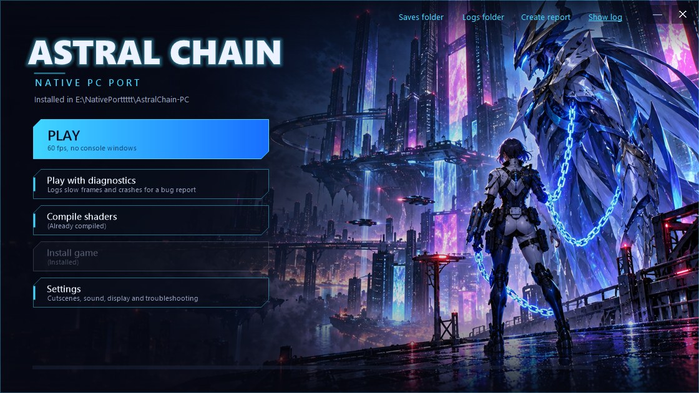

# Astral Chain PC

**Astral Chain PC** is an unofficial native Windows port of *Astral Chain* (Nintendo Switch, PlatinumGames, 2019),
made by static recompilation: the game's ARM64 code is translated to C and compiled into an ordinary Windows x64
program, and its graphics run on Vulkan. There is no emulator and no JIT
([how it works](docs/how-it-works.md)).

> [!IMPORTANT]
> **No game files are included.** You need your own legally obtained copy of *Astral Chain*, dumped from your own
> console: the base game, the v1.0.1 update and your `prod.keys`. How to dump them is not covered here, and requests
> for game files will be closed.
>
> The game is built from your files on your PC, so the result contains the game. It is for your own use: do not share
> the `build`, `game` or `userdata` folders.

> [!NOTE]
> **This project was built entirely with AI.** All of the code, tooling, reverse engineering and documentation in
> this repository was written by an AI model (Anthropic's Claude, through Claude Code, and Codex), directed, tested
> and reviewed by the project's owner. It is shared as is, as a fan project. As with any code from the internet, you
> build and run it at your own discretion.

## Status

| | |
| --- | --- |
| Tested | From the title screen through File 01 (its boss fight included) and File 02, into File 03, with the in-game camera taking photos (played by the owner) |
| Frame rate | 60 fps target, cutscenes included (Dynamic-FPS patch, game speed correct at any frame rate). RTX 4090 / Ryzen 7 7800X3D: 57-60 fps. `AC_CUTSCENE_FPS=30` plays cutscenes exactly as the original does |
| Stability | Driver watchdog plus a GPU hang stop. No driver resets since 2026-10-19 across dozens of test runs |
| Saving | Works (tested in File 01) |
| Shader pauses | Shaders are compiled for your GPU before the game starts. Simulated first play of an area never recorded: 7 pauses over 50 ms, 0.49 s in total (26 and 8.0 s before 2026-10-21) |
| Controllers | Keyboard and mouse, and Xbox-style pads through XInput (every connected pad is read). Other pads (Switch Pro Controller, DualSense, DualShock 4, 8BitDo) go through SDL3: tested with a virtual SDL pad only, not yet with a real one |
| Integrated GPUs | A memory copy meant for dedicated graphics cards is off on integrated GPUs: highway chase effects at 46-56 fps instead of 5-6 on an Intel Arc laptop (Linux). Not yet tested on a Windows integrated GPU |
| Not yet tested | The rest of File 03 and everything after it |

What changed and when: [What's new](docs/changelog.md). Open problems: [Known issues](docs/known-issues.md). Report
problems as [issues](https://github.com/Puddz/AstralChain-PC/issues): play with **Play with diagnostics** until it
happens, then attach the zip that **Create report** makes (it holds no game files).

## Features

- Native code, not emulation: the game's ARM64 code is translated to C and compiled for Windows x64, and its NVN
  graphics calls run on Vulkan
- Base game with its v1.0.1 update, built on your PC from your own dump
- 60 fps, in-engine cutscenes included, with each camera cut kept at its original length to stay with the voices
  (not yet confirmed in play); a 30 fps cutscene switch, and an uncapped frame rate (experimental)
- A launcher that installs, updates and starts the game, with every setting explained
- In-game settings menu (**F1**, or Minus and Plus on a controller) and a frame rate panel, from a plain counter to
  frame time graph, 1% lows, GPU and CPU load
- Keyboard and mouse with remapping and mouse camera; Xbox controllers, and Switch Pro, DualSense, DualShock 4 and
  8BitDo pads through SDL3; rumble; button prompts for keyboard, Xbox, PlayStation or Switch, following what you use
- Shaders compiled for your GPU before the game starts, not during play
- BC7 texture compression for GPUs with 8 GB of video memory or less (7.2 GB down to 4.7 GB in the highway chase)
- Saving, with an automatic backup of the newest 30 saves
- Input recording and one-click reports, so a bug can be replayed from the place it happened
- Closes the game on a graphics driver error or a GPU hang, before Windows resets the driver

## Installing

Download the zip from the [latest release](https://github.com/Puddz/AstralChain-PC/releases/latest) (or `git clone`
this repository), unzip it to a short local path such as `C:\Games\AstralChain-PC`, start
**`Astral Chain Launcher.exe`** and press **Install game**. It asks for:

- your `prod.keys`;
- your own copy of the base game (title ID `01007300020FA000`, XCI or NSP);
- the v1.0.1 update NSP (exactly v1.0.1).

It then extracts the game's data, translates the game's code to C, and compiles the game and its shaders on your PC:
roughly **15-40 minutes** the first time. If a step fails, fix the cause and press **Install game** again; finished
steps are skipped. Without the launcher, `setup.cmd` does the same in a console window
(`setup.cmd --keys X:\prod.keys --base X:\AstralChain.xci --update X:\AstralChain-v1.0.1.nsp`).

You need:

- Windows 10 or 11, 64-bit.
- A GPU with Vulkan 1.3. Developed on an NVIDIA RTX 4090; other GPUs are untested.
  With 4 GB of video memory, turn on **Texture compression** and *Keep the game's memory copy in system RAM*
  (Settings; experimental, see [settings](docs/settings.md#shaders-and-performance)).
- About **35 GB** free during setup. About 11 GB stays afterwards.
- An internet connection for the one-time setup. It downloads Python, Zig, glslang, NSTool and SDL3 at pinned
  versions, checked by SHA-256. No Python install is needed.

The launcher is unsigned, so Windows SmartScreen may warn on the first start. Its source is `launcher\Launcher.cs`.

**Updating:** unzip the new version over the old one, or `git pull`. The next **Play** rebuilds the game once, in
about a minute. Saves, settings (both in the `userdata` folder), game data and the shader cache are kept. To move the
port, move the whole folder.

**Linux / Steam Deck (Proton):** not supported here, and untested by this project. mohdrahk runs the port on
Linux through Proton and keeps a community guide with build and update scripts on their fork:
[mohdrahk/AstralChain-PC, branch `linux`](https://github.com/mohdrahk/AstralChain-PC/tree/linux) (see
`linux/README.md`; background in [issue #6](https://github.com/Puddz/AstralChain-PC/issues/6)). Problems on Linux
are best raised there.

## Playing

Start **`Astral Chain Launcher.exe`** and press **Play**.

- [Playing](docs/playing.md): the launcher, default keys, mouse, controllers, the in-game menu, texture
  compression, saves and logs
- [Settings](docs/settings.md): what every setting does
- [What's new](docs/changelog.md)
- [Known issues](docs/known-issues.md) and [troubleshooting](docs/troubleshooting.md)
- [How it works](docs/how-it-works.md) and [development notes](docs/development.md)

## Branches

| Branch | For |
| --- | --- |
| [`main`](https://github.com/Puddz/AstralChain-PC) | **Most players.** |
| [`upscaling`](https://github.com/Puddz/AstralChain-PC/tree/upscaling) | `main` plus render resolutions, ultrawide and AMD FSR 1 (experimental) |
| [`texture-dump`](https://github.com/Puddz/AstralChain-PC/tree/texture-dump) | `upscaling` plus texture dumping and replacement for modders (experimental) |

The [release](https://github.com/Puddz/AstralChain-PC/releases/latest) holds a zip of each. Each branch is its own
install: unzip it to its own folder.

## Credits

- [LASRecomp](https://github.com/peiikai/LASRecomp) (MIT): the ARM64 lifter, the NVN-on-Vulkan layer and the
  Maxwell shader translator this port builds on.
- [AstralChain-Dynamic-FPS](https://github.com/yogesh1239/AstralChain-Dynamic-FPS) by yogesh1239 (MIT): the
  60 fps patch.
- [astral-extractor](https://github.com/cabalex/astral-extractor) by cabalex: format research.
- The launcher's backgrounds and icon (`launcher/art/`, `launcher/icon.ico`) are original AI-generated images in the
  style of the game, without official artwork. The default (`1-visor.jpg`) was chosen by the project's owner; the
  other five and the icon were made with OpenAI Codex's image generation for this project.
- [AC-Recomp](https://github.com/swaymun/AC-Recomp): the macOS recompilation, whose setup flow inspired this one.
- [AMD FidelityFX Super Resolution 1](https://github.com/GPUOpen-Effects/FidelityFX-FSR) (MIT): the EASU and RCAS
  shaders of the FSR 1 path (through LASRecomp), used by the experimental upscaling option.
- [TotK Recomp](https://github.com/valentderah/totk-pc-recomp): the detailed frame rate panel reads the GPU's
  load, temperature, power and clock the way its performance overlay (`runtime/perfmon.c`) does.
- [NSTool](https://github.com/jakcron/nstool), [Zig](https://ziglang.org/),
  [glslang](https://github.com/KhronosGroup/glslang), [SDL](https://www.libsdl.org/) (zlib; its `SDL3.dll` is
  downloaded by setup, for controllers), [Vulkan-Headers](https://github.com/KhronosGroup/Vulkan-Headers),
  [VulkanMemoryAllocator](https://github.com/GPUOpen-LibrariesAndSDKs/VulkanMemoryAllocator),
  [Capstone](https://www.capstone-engine.org/), [lz4](https://github.com/python-lz4/python-lz4).

## License

The project's own code is under the [MIT License](LICENSE); third-party code keeps its own license
([THIRD_PARTY_NOTICES.md](THIRD_PARTY_NOTICES.md)). The license grants nothing for Nintendo's game.

Astral Chain PC is an independent, non-commercial fan project, not affiliated with or endorsed by Nintendo or
PlatinumGames. *Astral Chain*, *PlatinumGames* and *Nintendo Switch* are trademarks of their respective owners. No
game code, assets, shaders, keys or firmware are distributed.

## Building from source

Setup builds everything from source on your PC; there is no separate build to do. The translator, the build system
and the Windows runtime are in `astral_chain/`, the launcher in `launcher/` (`python launcher\build.py` builds it
with the C# compiler that comes with Windows). See [development notes](docs/development.md).
