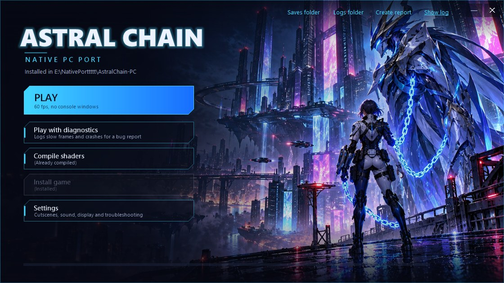

# Playing

Start **`Astral Chain Launcher.exe`**:

The arrows at the top right (**BACKGROUND ‹ 1 / 6 ›**) switch between six backgrounds; the choice is remembered.

| Button | What it does |
| --- | --- |
| **Play** | Starts the game, without console windows. After an update of this project it first rebuilds the game (about a minute) and its shaders |
| **Play with diagnostics** | The same, plus a log of where the time of each slow frame went and a crash dump if the game crashes. Afterwards it offers to create a report |
| **Compile shaders** | Prepares every shader for your GPU now. It says *(Already compiled)* when nothing changed, and *(Needs recompiling)* after an update of the game build, new recorded shader combinations, or a settings change that affects them. Play does this too when needed |
| **Settings** | Cutscene frame rate, pausing while minimized, save backups, sound resync, fullscreen, the title screen options, presentation mode, handheld mode (1280x720), render resolution and upscaling (see [Experimental options](#experimental-options)), texture compression (BC7, see below), shader options and troubleshooting switches. Each one is explained in the window and in [docs/settings.md](settings.md) |
| **Controls** | The keyboard keys for every button, stick direction and the D-pad. Click a key, then press the new one; a key already in use swaps places |
| **Create report** | Packs the last session's logs, the crash dump if there is one, and your Windows, CPU and GPU versions into `reports\`, for a bug report. No game files; your Windows user name is removed from the logs' paths |

`Play Astral Chain.cmd` and `Play Astral Chain (diagnostics).cmd` still work, with console windows.

Default keys and mouse buttons (change them with **Controls**; every action has a main and an alternative binding):

| Switch | What it does | Main | Alternative |
| --- | --- | --- | --- |
| ZR | Attack | Left click | C |
| ZL | Legion (summon, send, recall; hold to steer it) | Right click | Z |
| A / B / X / Y | Interact / dodge / item / switch Legion | J / K / I / U | B: Space |
| L / R | Legion action / dismiss Legion | Q / E | Mouse back / forward |
| + / - | IRIS / pause menu | Enter / Backspace | Tab / Esc |
| Left stick | Move | W A S D | |
| Right stick | Camera | Mouse (see below) and T F G H | |
| Left / right stick press | Sprint or crouch / re-centre the camera | Shift / Middle click | 1 / 2 |
| D-pad | Up and down: weapons | Arrow keys | Up and down: mouse wheel |

**Mouse.** Click in the game window to give it the mouse: the cursor hides and the mouse turns the camera (and
steers your Legion while ZL is held). Hold **Alt**, or switch to another window, to get the cursor back; click again
to resume. Sensitivity and invert are in **Settings > Mouse and keyboard**.

**Button icons.** By default the game's button prompts follow what you last used: your keys and mouse buttons (the
main binding of each action) on the keyboard, the buttons of an Xbox, PlayStation or Switch controller on a
controller. **Button icons** in the in-game menu or the launcher's **Settings > Mouse and keyboard** fixes one style.

**In-game menu.** **F1**, or **Minus and Plus** together on a controller (Back and Start, Share and Options), opens
the settings menu over the game; the game pauses while it is open. Esc, F1 or Minus and Plus close it. Changes that
need a restart say so. The menu saves to the same settings file as the launcher. **Quit game** at the bottom of the
menu closes the game, after asking first, so a controller alone is enough.

**HUD layout** (render resolutions wider than 16:9). **F2**, or **HUD layout** in
the F1 menu, opens a window where you choose where the HUD's side panels go: for each corner, how far toward the
screen's edge and how far up or down. F2, Esc or B close it.

F11 or Alt+Enter: fullscreen on or off (F11 and Alt stay game keys if you assign them in **Controls**).

**Title screen.** The scene behind the title is a video of one of the twins on a roof, in the outfit of your newest
save. The game shows the twin you did **not** choose (your sibling); **Settings > Display > Title screen shows the twin
you play as** (or the in-game menu) shows yours instead, from the next time the title screen appears. Your save is not
changed. A small **"Port by Puddz"** shows above the version number; the same Display settings turn it off.

## Experimental options

All are in **Settings > Display** and off by default; they apply the next time you press **Play**.

| Setting | What it does |
| --- | --- |
| **Render resolution** | The size the game draws at: 1600x900 (default, the Switch's docked size, with the game's own dynamic resolution), 1920x1080, 2560x1440 or 3840x2160, at a fixed size. Larger sizes need a faster GPU and more video memory. Measured on an RTX 4090 in the highway chase: about 60 fps at every size |
| **Render resolution, small** | 1280x720, 960x540 or 854x480, for GPUs that cannot hold 60 fps at 1600x900. Only the 3D view is drawn at that size and scaled up by the game (softer picture); the HUD and menus stay at 1600x900. Handheld mode ignores them |
| **Render resolution, ultrawide** | 2560x1080 or 3440x1440 (21:9), 3840x1080 or 5120x1440 (32:9), 5760x1080 or 7680x1440 (48:9, three screens; 7680x1440 is drawn at 6788x1272). The 3D view gets wider (nothing is stretched), the HUD keeps its 16:9 layout in the middle, and the window opens at that shape; in fullscreen on an ultrawide screen the picture fills it. Checked in screenshots of the street and the opening cutscene; cutscene movies, menus and real ultrawide monitors are untested |
| **Upscaling** | *Smooth* (default) scales the picture to a larger window or screen; *AMD FSR 1* uses edge-aware upscaling and sharpening, crisper on 1440p and 4K screens. Works on any GPU |

The resolution comes in through a code patch (`astral_chain/patches/resolution-1.0.1.pchtxt`): the game asks the
runtime for its render size, dynamic resolution levels, render target memory and camera aspect, so the size can be
changed at launch without a rebuild. Without the setting, the game's own values are used.

## Texture compression (BC7)

For GPUs with 8 GB of video memory or less. Most of the game's textures are ASTC, which PC GPUs cannot read, so
they are unpacked to 4 bytes per pixel. **Settings > Texture compression (BC7)** stores them as BC7 instead, a
quarter of that size. Off by default. Measured on a fresh install, highway chase, 3 runs each (RTX 4090):

| | Off (default) | **On: converted on the GPU** | **On: prepared at setup (best)** |
| --- | --- | --- | --- |
| What it does | Textures unpacked as before | Each texture is converted on the GPU as it loads | Every texture is converted once, on the CPU, and stored on disk; the game loads those |
| Video memory (average / peak) | 7.2 / 8.7 GB | 4.7 / 5.2 GB | 4.7 / 5.1 GB |
| Preparation | None | None | About 12 minutes, once (at the next Play) |
| Disk space | None | None | 16 GB (`build\game\cache\bc7`) |
| Short pauses per run | 6-8 | 11-12: about 5 more, of 60-100 ms, while an area loads | 6-7 |
| Picture | Original | Slightly less detail on some surfaces (bumps, reflections) | Very close to the original |

Picture quality measured on 300 of the game's textures (PSNR against the original, higher is better): 46 dB
average on the GPU, 51 dB prepared at setup; the GPU's worst texture was 27 dB, setup's 34 dB.

Switching to *prepared at setup* says when the preparation will run; switching away offers to delete the 16 GB.
With less than 20 GB free, setup skips the preparation and the game converts on the GPU instead.

**Controllers.** Xbox pads and compatibles work through XInput. Other controllers work through SDL3: Switch Pro
Controller, DualSense, DualShock 4, 8BitDo and most USB or Bluetooth pads SDL knows. The buttons follow their
*position*, as on the Switch: the right face button is A and the bottom one B, whatever their labels.
**Swap A and B** (**Settings > Controller**, or the in-game menu) makes the bottom button A instead, as in most PC
games; the button icons follow, and the keyboard keeps its keys. The first
controller found is used; plug it in before or while the game runs. Controllers rumble when the game asks for it
(**Settings > Controller > Rumble strength**, 0 turns it off). Not supported yet: the Switch 2 Pro Controller
and Switch 2 Joy-Cons (SDL's Windows build has no driver for them). With Steam, adding the game as a non-Steam game
with Steam Input on may work for those; that is untested. *Not yet confirmed with a real non-Xbox controller.*

The game pauses while its window is minimized, as on the Switch's home menu (Settings: *Keep running while the game
window is minimized*). In another window, the game keeps running but takes no keyboard input.

- **Saves** are in `userdata\saves\` (the launcher's *Saves folder* link). Each save is also copied next to it
  (the newest 30 are kept); still, back that folder up from time to time.
- **Logs** of the last session are in `build\game\round-00\` (`trace.log`, `stderr.log`).
- **Shaders.** Before the game starts the first time, setup translates all of the game's shaders ("Preparing
  shaders", about 20 s on a 16-thread CPU), then compiles them for your GPU and driver ("Compiling for your GPU"),
  together with the render-state combinations recorded so far. Later launches skip both unless something changed
  (a game update or a new graphics driver); new combinations recorded in play are done alone at the next launch. A combination never seen before is linked
  from the compiled shaders when first drawn, without a long pause. The cache is in `build\game\cache\`.

## Safety

The game always runs under `astral_chain\run_guarded.ps1`, from the launcher too. It closes the game on the first
GPU driver error that Windows logs. The game also stops itself if the GPU stays busy for more than 1.2 s, before Windows would reset the driver.

## Updating

Download the new version over the old one, or `git pull`. The next **Play** rebuilds the game once, in about a
minute. Your saves, game data and shader cache are kept.

Your saves and settings are in the folder's `userdata` folder, and nothing else holds them. To move the port, move
the whole folder; to start again from a fresh download, copy `userdata` into the new folder before the first
**Play**. A moved or copied folder is built again on its next **Play**.

## Folder layout

| Path | What |
| --- | --- |
| `Astral Chain Launcher.exe` | The launcher (source in `launcher/`) |
| `setup.cmd`, `Play Astral Chain.cmd` | The same steps from a console window |
| `astral_chain/` | Translator driver, build system and Windows runtime (C) |
| `astral_chain/patches/` | Code patches of this project (pchtxt) |
| `third_party/` | Vendored sources: LASRecomp, Vulkan-Headers, VulkanMemoryAllocator, Dynamic-FPS patch |
| `docs/` | How it works, troubleshooting, development notes |
| `tools/` | *(created by setup)* Python, Zig, glslang, NSTool, SDL3 |
| `game/` | *(created by setup)* your extracted update code, metadata and `romfs.bin` |
| `build/` | *(created by setup)* the compiled game and its shader cache |
| `userdata/` | *(created by setup)* saves, account profile, setup choices, launcher settings (`launcher.ini`) |
| `reports/` | *(created by the launcher)* reports made with **Create report** |
